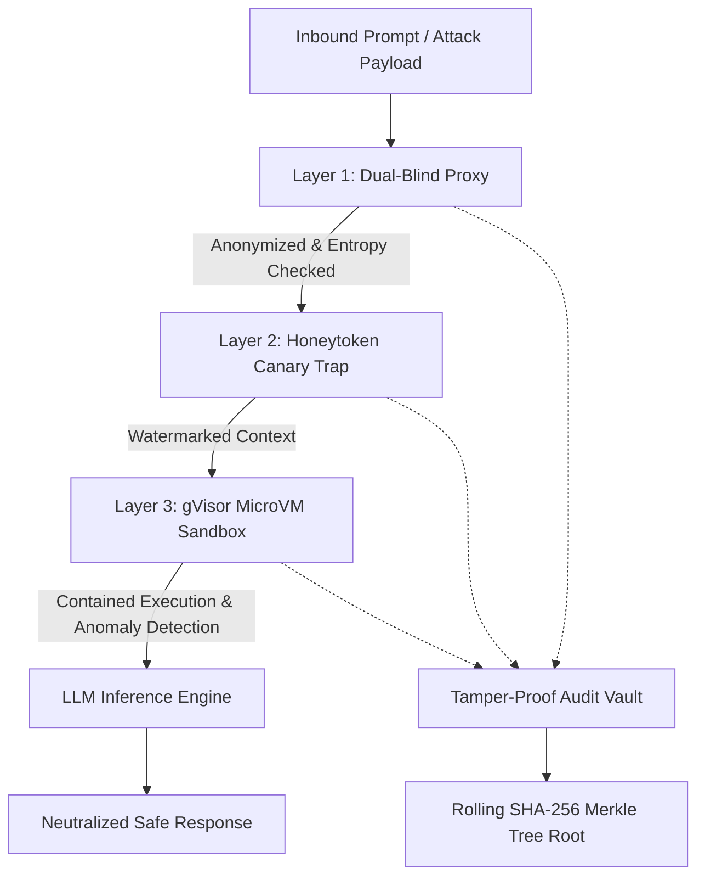

# Cerberus AI 🛡️

> **Tri-Layer, Zero-Trust Adversarial AI Safety & Red-Teaming Enclave**  
> *Built for Hack in Hills 2026 (Problem Statement 4 — Bayora Challenge)*  
> *Powered by TinyFish & Render*

[](https://fastapi.tiangolo.com)
[](https://python.org)
[](https://owasp.org/www-project-top-10-for-large-language-model-applications/)
[](https://en.wikipedia.org/wiki/Merkle_tree)
[](LICENSE)

---

## 👥 Team: Cypher Chasers
- **Naitik Dhiman** ([@naitikdhiman](https://github.com/naitikdhiman))
- **Rishi Agarwal**

---

## 🚨 Problem Statement (Bayora Challenge — Problem 4)

Modern enterprises deploy Large Language Models (LLMs) with access to **confidential enterprise data, internal API credentials, EHR health records, and proprietary instructions**. Traditional firewalls are completely blind to semantic payloads:
- **System Directive Extraction**: Attackers tricking models into dumping proprietary instructions.
- **Jailbreaks (D.A.N. & Persona Shifts)**: Bypassing safety alignment through adversarial framing.
- **Token Smuggling**: Bypassing naive regex filters using sub-word tokenization.
- **Data Exfiltration via Tool Hijacking (SSRF)**: Weaponizing tool-calling agents to exfiltrate private intranet data.

---

## 💡 The Solution: Tri-Layer Zero-Trust Enclave

Cerberus AI wraps any LLM in three independent, complementary defense layers:



### 1. Dual-Blind Proxy
- Anonymizes session context and separates user identity from model inference.
- Analyzes prompt semantic entropy and heuristic adversarial patterns.

### 2. Dynamic Honeytoken Canary Trap
- Injects cryptographic canary tokens into system contexts.
- Actively monitors outbound tokens for exfiltration signatures; triggers instant containment upon token reflection.

### 3. gVisor MicroVM Sandbox & Syscall Interception
- Isolates tool executions and model runtimes with network namespace constraints.
- Real-time eBPF anomaly detection neutralizes unauthorized SSRF or shell access.

### 4. Cryptographic Audit Vault (SHA-256 Merkle Tree)
- Every prompt, intercepted attack, and defense event is assigned a SHA-256 leaf hash.
- Leaves roll up into a verifiable Merkle Root for mathematically guaranteed non-repudiation.

---

## 🌟 Key Features

- **Adversarial Testing Range**: Pre-configured with OWASP LLM Top 10 attack vectors (System Directive Extraction, Tool SSRF, DAN Jailbreak, Token Smuggling, RAG Poisoning).
- **Custom Model Onboarding**: Zero-configuration registration of enterprise models (e.g., healthcare diagnostic agents) with automated canary token protection.
- **Mathematical Audit Proof**: One-click verification of the rolling Merkle tree proof to detect log tampering.
- **Automated Benchmark Suite**: Quantitative, reproducible defense scoring across all OWASP categories.
- **Interactive Security Workbench**: Terminal-grade dark-mode web console with live log streaming.

---

## 🔌 API Endpoints

| Method | Endpoint | Description |
| :--- | :--- | :--- |
| `GET` | `/` | Serves the interactive Security Workbench web UI |
| `GET` | `/api/presets` | Returns all pre-configured OWASP attack scenarios |
| `POST` | `/api/run-probe` | Executes an adversarial probe against the enclave |
| `POST` | `/api/custom-model` | Registers a custom model with protected secrets |
| `GET` | `/api/audit-logs` | Retrieves all cryptographically signed event leaves |
| `GET` | `/api/verify-merkle` | Computes & verifies mathematical proof of log integrity |
| `POST` | `/api/benchmark` | Runs full OWASP benchmark scan and returns scorecard |

---

## 🚀 Quickstart & Installation

### 1. Clone the repository
```bash
git clone https://github.com/<YOUR_USERNAME>/cerberus-ai.git
cd cerberus-ai
```

### 2. Install dependencies
```bash
pip install -r requirements.txt
```

### 3. Launch the Server
```bash
uvicorn app:app --host 127.0.0.1 --port 8000 --reload
```

Open your browser to: **`http://127.0.0.1:8000`**

---

## ☁️ Deploy to Render (Render Workflows)

This project includes a `render.yaml` blueprint ready for 1-click cloud deployment:

1. Push this repository to GitHub.
2. Go to the [Render Dashboard](https://dashboard.render.com).
3. Select **New +** → **Blueprint**.
4. Connect this repository and click **Apply**.
5. Render will build and deploy the web service automatically.

---

## 📂 Project Structure

```text
.
├── app.py              # FastAPI application & Merkle Tree audit engine
├── static/             # Frontend Security Workbench
│   ├── index.html      # UI layout
│   ├── app.js          # Real-time event streaming & interactive UI logic
│   └── style.css       # Terminal dark-mode design system
├── requirements.txt    # Production dependencies (fastapi, uvicorn, pydantic)
├── render.yaml         # Render Workflows cloud deployment configuration
├── .gitignore          # Git exclusion rules
├── LICENSE             # MIT License
└── README.md           # Project documentation
```

---

## 📜 License

Distributed under the **MIT License**. See `LICENSE` for details.

---

*Team Cypher Chasers — Naitik Dhiman & Rishi Agarwal | Hack in Hills 2026*
